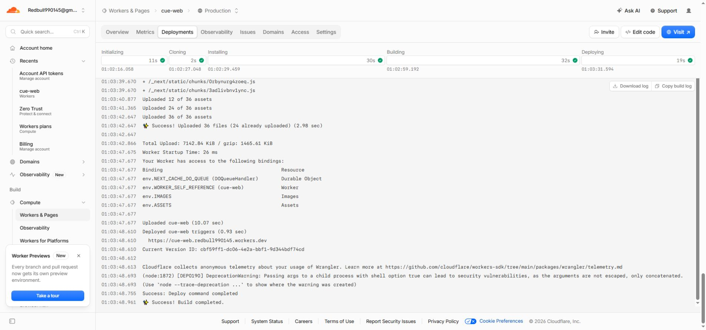

# Cloudflare deployment repair and security checks

Verified on 2026-10-14. The source fixes are included in the same change set as this report. The live deployment verification below concerns the previously pushed commit `cd82cc4`; deployments of the new fixes must be checked separately.

## Deployment failure and live repair

Two independent publishers failed for different reasons on commit `cd82cc4b3e4401d3df4c36c26dfd8b67521ec90a`:

1. Cloudflare Workers Builds ran `npm run build` and `npx wrangler deploy` from `/`. The first command built the monorepo's ordinary Next output without creating the OpenNext worker. Wrangler reported: “The Cloudflare application detection logic has been run in the root of a workspace instead of targeting a specific project.” The build also had no `NEXT_PUBLIC_API_URL` variable.
2. GitHub Actions `deploy-web` stopped during deployment-input validation. Its API URL, Cloudflare account ID and Cloudflare API token inputs were empty. The CI `check` job and Vercel deployment passed; neither verified the Cloudflare adapter.

Updated and saved the existing Cloudflare project's configuration:

| Setting | Value |
| --- | --- |
| Root directory | `/` |
| Build command | `npm exec --workspace @cue/web -- opennextjs-cloudflare build` |
| Deploy command | `npm exec --workspace @cue/web -- opennextjs-cloudflare deploy` |
| Non-production version command | `npm exec --workspace @cue/web -- opennextjs-cloudflare upload` |
| Build variable | `NEXT_PUBLIC_API_URL=https://podcast-68rl.onrender.com` |

The API URL was verified against the existing public deployment's assets and a successful API health response. No credentials were created, changed or printed. No new billing or storage setup was required.

Retried the already-pushed commit. [Cloudflare build 5bfc181c](https://dash.cloudflare.com/689e29d8b9b707374088d6d1be973ffa/workers/services/view/cue-web/production/builds/5bfc181c-7fbc-4fc2-8508-8c383b2d2072) completed successfully in 1m 35s and deployed version `cbf59ff1-dc06-4e2a-bbf1-9d344bdf74cd`. Upload: 1465.61 KiB gzip; worker startup: 26 ms.

Public HTTP verification: `/`, `/signin` and `/sw.js` each returned 200 with `X-Cue-Revision: cd82cc4b3e4401d3df4c36c26dfd8b67521ec90a`. The configured API `/health` returned 200 and `status: up`.

Cross-origin verification using the deployed worker's origin: catalogue `/categories` and `/auth/get-session` returned 200 with the correct `Access-Control-Allow-Origin` and credentials enabled. Sign-in OPTIONS preflight returned 204 with POST and content-type allowed. No user credentials were submitted.

Additional evidence: [original build failure](cloudflare-original-failure.png) and [saved build settings](cloudflare-build-settings.png).

## Source changes prepared for the next push

- Validate the Cloudflare release API URL before building, including direct adapter calls under `WORKERS_CI=1`. Reject missing, insecure, loopback and credential-bearing URLs without printing their values.
- Build the Cloudflare adapter during CI, using a synthetic HTTPS API URL for a validation artifact that is never published.
- Make GitHub deployment an explicit alternative publisher (`CLOUDFLARE_DEPLOY_FROM_ACTIONS=true`). The active publisher is Cloudflare Workers Builds; optional GitHub deployment retains its required credential checks and accepts the existing `API_URL` secret as a fallback.
- Correct deployment documentation to match the active publisher and build settings.

The old GitHub deployment failure remains in that historical run. The workflow correction takes effect after the source changes are pushed.

## Security findings and fixes

### Authentication throttling gaps

The sensitive-auth guard omitted Better Auth's `/request-password-reset` and `/change-password` endpoints. Added both paths and regression coverage showing the fourth attempt receives 429. Before the fix, the new cases failed because the guard allowed requests through.

Password reset email delivery is currently disabled; the test covers the route guard, not a demonstrated live email-spam exploit. The password-change endpoint is an active credential-check surface. Distributed rate limiting still depends on the existing production Redis configuration.

### Account metadata in shared catalogue caches

The service worker could cache an authenticated response from a public catalogue endpoint, including `X-Cue-Account-Id`, then return it under another account. The client could interpret that stale owner header as an account mismatch and sign out. Catalogue bodies are public; the finding concerned identity metadata and incorrect sign-outs.

Fetch shared catalogue routes anonymously, strip identity headers, reject `private`, `no-store` and owner-tagged responses, and reject unsafe legacy cache entries on read. Bumped the service worker cache version from v5 to v6. Five new regression scenarios failed before the fix and passed afterward.

### Vulnerable transitive dependencies

Applied scoped overrides after checking their actual consumers:

| Consumer | Patched dependency | Compatibility verification |
| --- | --- | --- |
| `@esbuild-kit/core-utils` | esbuild 0.28.2 | TypeScript transform strips types |
| Metro | image-size 2.0.4 | Real PNG asset parses as 180 by 180 |
| xcode | uuid 11.1.1 | 20 generated identifiers match its required format |

Live npm 10.9.9 audit, matching the existing GitHub runner: **38 to 25 findings** (moderate 15 to 3; high 23 to 22). These counts include propagated findings, not 38 distinct exploitable bugs. Explicit online auditing was necessary because the local npm configuration defaults to offline mode.

The final machine-readable audit is saved in [cloudflare-security-audit.json](cloudflare-security-audit.json).

Three underlying advisories remain through mobile or development tooling:

| Package / advisory | Reason retained |
| --- | --- |
| braces / GHSA-vfj7-8cjw-p6xm | Latest published 3.0.3 remains affected; no published patch |
| node-forge / GHSA-86w9-cpqp-85rv | Latest published 1.4.0 remains affected; no published patch |
| decode-uri-component / GHSA-vcc3-ghjq-m6fr | Patched 0.5.0 changes to ESM and breaks query-string7's CommonJS caller; upgrading query-string also breaks Expo Router's namespace API |

The resolved web/API runtime closure contained 343 lockfile nodes with no unresolved dependencies and no remaining audit nodes reachable. Workspace-filtered npm audit still projects two shared glob findings from the monorepo's global dependency flags, so the repository-wide audit is **not clean**. This dependency review is not proof that production has no vulnerabilities.

## Validation

- Web regression suite: 66/66 passed; web TypeScript check passed.
- Focused API security suite: 128/128 distinct tests passed across eight files. The auth file was retried independently after a PGlite initialization timeout under concurrent load; its 18 tests passed. API TypeScript and lint passed.
- Full local OpenNext production build passed, including Next compilation and TypeScript checking.
- npm 10 `ci --dry-run` accepted the patched lockfile; consumer compatibility checks above passed.
- Local Wrangler deployment dry run passed: 1466.36 KiB gzip; no upload or deployment performed.
- App shell JavaScript budget passed: 127.0 KB gzip against a 140 KB limit.
- `npm run check -- --concurrency=1` passed: 32/32 workspace tasks, including all 1,602 tests, lint and TypeScript checks (26 previously passed tasks reused from Turbo's cache). This includes 675 API tests, 66 web tests and 28 database tests. The first concurrent run exceeded the unchanged 30-second timeout in two PGlite migration tests; both passed sequentially. No timeout limits or database code were changed.

This was a quick source, dependency and regression-test review. No load attack or authenticated production penetration test was performed. The initial successful live deployment verified above contains commit `cd82cc4` and service worker v5; the new security fixes, v6 cache policy and workflow changes take effect when this change set is deployed.
