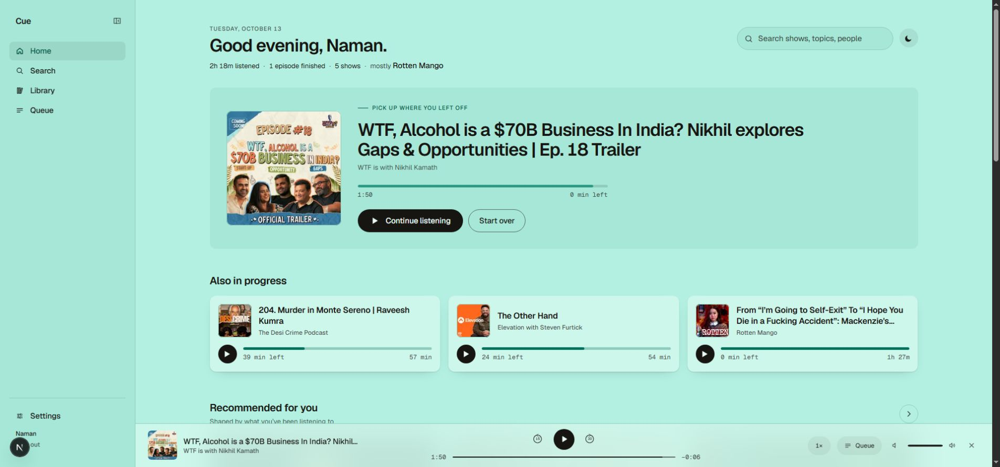
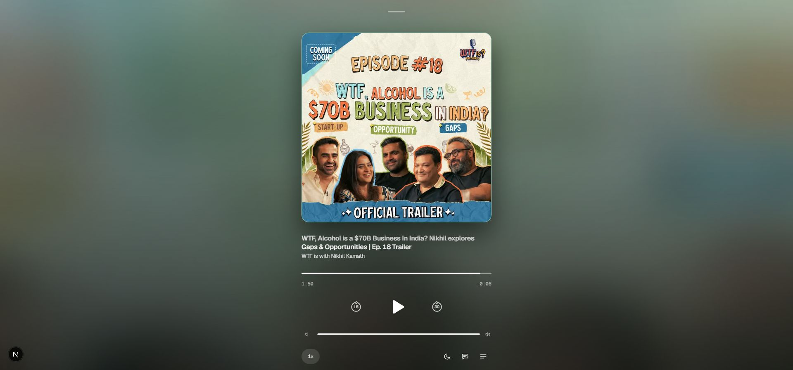

# Cue playback, navigation, color and motion verification

Verified locally on October 13, 2026. Existing unrelated workspace changes were preserved; no commit or deployment was made.

## Result

- Home's leading episode comes directly from the active player, including while saved history is pending. Other history cards exclude it. Home and the player use the same live clock; source changes reset that clock.
- The app color sweep compares podcast IDs. Episodes within one podcast and theme toggles do not start a new sweep. Initial playback also applies its palette without a sweep.
- Light artwork palettes retain more hue below white, with darker foreground/status colors to preserve contrast. Dark palettes retain their existing colors.
- Primary navigation fully prefetches the five persistent destinations. A route loading boundary provides immediate feedback for a missing payload. Home streams discovery separately from its greeting and playback. Search and category data warm on pointer/focus using their existing query caches.
- The app palette changes once per event. The former animation repeatedly changed inherited root custom properties and restyled the entire document during a two-second fade. The sweep now animates transform and opacity.
- Expanded player artwork, color wash and secondary wash drift/breathe on independent 27–38-second cycles. Blur remains constant. Reduced motion removes the loops; hidden tabs pause them; the collapsed player releases its ambient layers after closing.
- Common buttons have immediate press feedback and a spring release. Show artwork lifts with a spring, episode rows highlight, the theme icon animates, and the shared standard/snappy/expressive springs have a controlled rebound.

## Checks

| Check | Result |
| --- | --- |
| Web regression suite | 47 passed |
| Design/color suite, including contrast checks | 360 passed |
| Motion suite | 58 passed |
| Web TypeScript | Passed |
| Web ESLint | Passed |
| Final Next production build | Passed |
| Git whitespace check | Passed |

Windows process sandbox restrictions initially blocked Vitest/Next workers with `spawn EPERM`. The checks passed when run with reviewed process permission. Next also emits its existing middleware-to-proxy deprecation warning.

## Browser evidence

The signed-in development app was exercised with the supplied WTF trailers and Desi Crime episode. Home and the mini-player displayed matching titles and timecodes after same-podcast and different-podcast episode changes. The screenshot below shows the richer light palette and matching Home/player metadata.

The expanded player had three running CSS animations. Two separate computed-style samples showed different transform matrices and wash opacities (primary wash 0.76236 to 0.569814; secondary wash 0.479726 to 0.28616). After closing, the ambient child count was zero.

Podcast-only sweep behavior has three automated identity-policy tests. The short live sweep was not captured reliably by the browser automation, so the screenshot is not evidence of that trigger timing. Reduced-motion and hidden-tab behavior are implemented; an OS-level preference switch was not exercised in this session.

## Local production response measurements

Three full HTTP requests per route were made against `next start` on loopback port 3010. All returned 200.

| Route | Response headers, ms | Complete body, ms |
| --- | --- | --- |
| Home | 147, 46, 49 | 161, 54, 56 |
| Search | 43, 36, 24 | 47, 66, 27 |
| Library | 121, 32, 34 | 124, 34, 36 |
| Queue | 30, 24, 21 | 68, 27, 23 |

The built app was also navigated through Home, Search, Library and Queue in the browser. The production proof used an anonymous session on the extra local origin; signed-in playback proof used the existing development origin.

Development baseline headers were Home 902 ms, Search 517 ms, Library 440 ms, and first Queue 10,035 ms. Warm development Queue was 186–265 ms, indicating significant first-route compilation overhead. These development and production measurements are different environments and must not be represented as a controlled before/after benchmark. Client click-to-paint latency, deployed network latency and device GPU frame rate were not measured.
